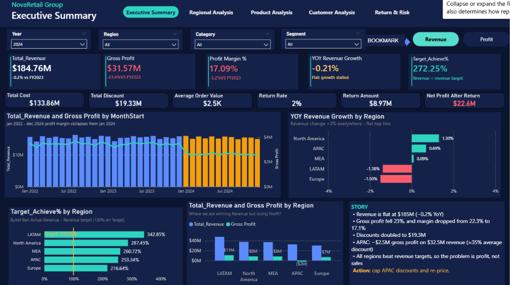

# Nova-Retail-dashboard
# NovaRetail Sales Performance Dashboard (Power BI)

An end-to-end Power BI project: cleaning a messy 225,800-row retail dataset, modelling it as a star schema, writing DAX measures, and building a 5-page interactive dashboard that explains **why profit fell 23% while revenue stayed flat**.

> **Note:** This is a practice project built on a dataset from a Power BI competition practice kit. The company, customers and figures are not real.



---

## The business question

NovaRetail sells across five regions (North America, Europe, APAC, LATAM, MEA). Revenue looked healthy, but profit was shrinking. The dashboard answers:

1. How are revenue, profit and margin trending, and against target?
2. Which regions generate revenue but lose profit?
3. Which products and categories perform best and worst?
4. How do customer segments behave?
5. How much do returns cost, and where do they come from?

## Key findings (FY2024 vs FY2023)

| Metric | FY2024 | Change |
|---|---|---|
| Revenue | $184.8M | -0.2% (flat) |
| Gross profit | $31.6M | -23.4% |
| Gross margin | 17.1% | down from 22.3% |
| Total discounts | $19.3M | roughly doubled |
| Return rate | 2.0% | steady in every region |
| Net profit after returns | $22.6M | |

- **APAC is the problem.** It produced $32.5M of revenue but a gross profit of **-$2.5M** (-$4.0M after returns). Its average discount was about **35%**, against about 5% in every other region.
- **Returns are not the cause.** The return rate is about 2% across regions and categories, so discounting, not returns, drives the loss.
- **Every region beat its revenue target** (217% to 343%), so the issue is profit, not sales volume.
- **Customers:** Consumer is about 50% of revenue, Corporate 30%, Home Office 20%. Average order value is about $2,500 in every segment, and each customer placed about 15 orders in FY2024.

### Recommendations

1. Cap APAC discounts and re-price (move toward the ~5% seen in other regions).
2. Review pricing and discounts on the 10 lowest-profit products (margins of 12% to 16%).
3. Target the fulfilment causes of returns: Damaged, Wrong Item and Late Delivery.

---

## Dashboard pages

| Page | What it shows |
|---|---|
| **Executive Summary** | KPI cards, monthly revenue vs gross profit, YoY growth and target achievement by region, Revenue/Profit bookmark toggle |
| **Regional Analysis** | Region/country matrix, discount % by region and year, profit vs revenue by store, margin trend by region |
| **Product Analysis** | Revenue and profit by category, return rate, top 10 and bottom 10 products |
| **Customer Analysis** | Segment mix, AOV by segment and month, top 10 customers, segment scorecard |
| **Returns & Risk** | Return reasons, net profit after returns, return rate by region, high-return products |
| **Order Details** (drill-through) | Order-level detail for a selected region |

Interactive features: Year / Region / Category / Segment slicers (synced across pages), bookmark toggle, drill-through from region to orders, dynamic text, conditional formatting for loss-making rows and a custom dark theme.

<details>
<summary>More screenshots</summary>


</details>

---

## Tools

- **Power BI Desktop**: modelling, DAX, report design
- **Power Query (M)**: data cleaning and transformation
- **DAX**: measures and calculated tables

## Data

Source: a practice kit with seven CSV files. The raw files are **not included** in this repository.

| File | Rows | Purpose |
|---|---|---|
| `fact_sales.csv` | 225,800 | Order lines: dates, customer, product, store, quantity, discount, revenue, cost |
| `fact_returns.csv` | 18,000 | Returned orders: reason, quantity, amount |
| `fact_targets_wide.csv` | 5 regions | Monthly revenue targets (wide format) |
| `dim_product.csv`, `dim_store.csv`, `dim_employee.csv` | | Product, store and employee attributes |
| `dim_customer_with_duplicates.csv` | | Customer attributes, with duplicate records |

## Data cleaning (Power Query)

Rule used throughout: **flag it, document it, keep it out of the KPIs.** Bad rows were kept in the data with a flag column, and a single `Is_valid` column controls what the measures count.

| Issue | Rows | Treatment |
|---|---|---|
| Duplicate sales rows | 800 | Removed |
| Revenue stored as text (`$`, commas) | 18,026 | Cleaned and converted to a number |
| Corrupted revenue (a number repeated as text) | 29 | Recovered the first value, flagged |
| Revenue outliers (up to ~$245K per row) | 436 | Flagged, excluded from KPIs |
| Negative quantities | 2,250 | Flagged, excluded |
| Orphan product ID `P9999` (not in `dim_product`) | 584 | Flagged, excluded |
| Country spelling variants (USA, U.K. ...) | 2,228 | Standardised |
| Blank customer names | 6,771 | Set to "Unknown" |
| Duplicate customer records | 50 | Removed on `CustomerID` |
| Store "City - State" in one column | | Split into two columns |
| Targets in wide (month-per-column) format | | Unpivoted |

3,255 rows were excluded, leaving **221,745 valid rows** for analysis.

## Data model

A star schema with `fact_sales` at the centre.

```
dim_customer ─┐
dim_product  ─┤
dim_store    ─┼── fact_sales ──── fact_returns
dim_employee ─┤
dim_date     ─┘          fact_targets (via dim_region and dim_date)
```

- `dim_date` is a calculated table, marked as the date table. `Order Date` is the active relationship and `Ship Date` is inactive (used with `USERELATIONSHIP`).
- `dim_region` is a small helper table so targets (by region) can be filtered together with sales.
- Dimension tables are not related to each other, and filters run in a single direction.

## Key DAX measures

Measure names follow the model. `Is_valid` is the flag column created in Power Query.

```dax
Total_Revenue =
CALCULATE ( SUM ( fact_sales[Revenue] ), fact_sales[Is_valid] = TRUE () )

Gross Profit = [Total_Revenue] - [Total Cost] - [Total Discount]

Profit Margin % = DIVIDE ( [Gross Profit], [Total_Revenue] )

Revenue LY =
CALCULATE ( [Total_Revenue], SAMEPERIODLASTYEAR ( dim_date[Date] ) )

YoY Revenue Growth % =
DIVIDE ( [Total_Revenue] - [Revenue LY], [Revenue LY] )

Return_Rate = DIVIDE ( [Returned Quantity], [Total Quantity] )

Target_Achieve% = DIVIDE ( [Total_Revenue], [Revenue Target] )

Net_Profit_After_Return = [Gross Profit] - [Return Amount]
```

Other measures cover distinct orders, average order value, discount %, return amount, customer rank (`RANKX`), dynamic KPI footer text and colour measures for conditional formatting.

### Modelling decisions worth noting

- **Discount is a rate, not a dollar amount** (values 0 to 0.40). Discount amount is therefore calculated as `Revenue × Discount %`. Multiplying quantity by the rate would give a meaningless number.
- **Region comes from the store where the sale happened** (`fact_sales[StoreID]` to `dim_store`). A second relationship path through `dim_employee` was removed, because it gave Power BI two routes and assigned regions by the employee's home store.
- **Target achievement** divides revenue by the revenue target. Revenue is well above target in every region (217% to 343%), so the useful signal on this page is the profit gap, not the target gap.

## How to open the report

1. Clone this repository and open the `.pbix` file in Power BI Desktop.
2. Get the practice dataset (not included), and place the seven CSV files in a folder.
3. In **Transform data > Manage parameters**, set `DataPath` to that folder.
4. Click **Refresh**.

## Project structure

```
├── README.md
├── NovaRetail_Dashboard.pbix
└── images/
    ├── 01_executive_summary.png
    ├── 02_regional_analysis.png
    ├── 03_product_analysis.png
    ├── 04_customer_analysis.png
    └── 05_returns_and_risk.png
```

## What I learned

- Profiling the data before building anything (here, 3,255 problem rows) changed every headline number. Without the validity flag, revenue would have been overstated by about $60M.
- A wrong relationship can look like a correct report. Region numbers were wrong until I found a second filter path through `dim_employee`.
- Checking every ratio's denominator matters. A return rate of 20% turned out to be returns divided by orders instead of by units sold.

## Author

**[Your Name]**
[LinkedIn](https://www.linkedin.com/in/your-profile) · [Email](mailto:you@example.com)
